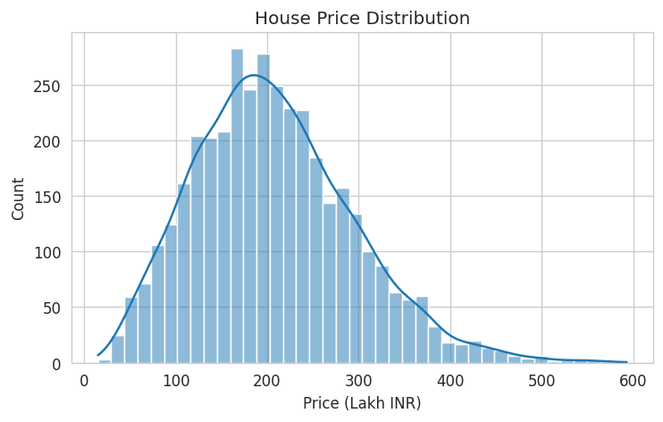
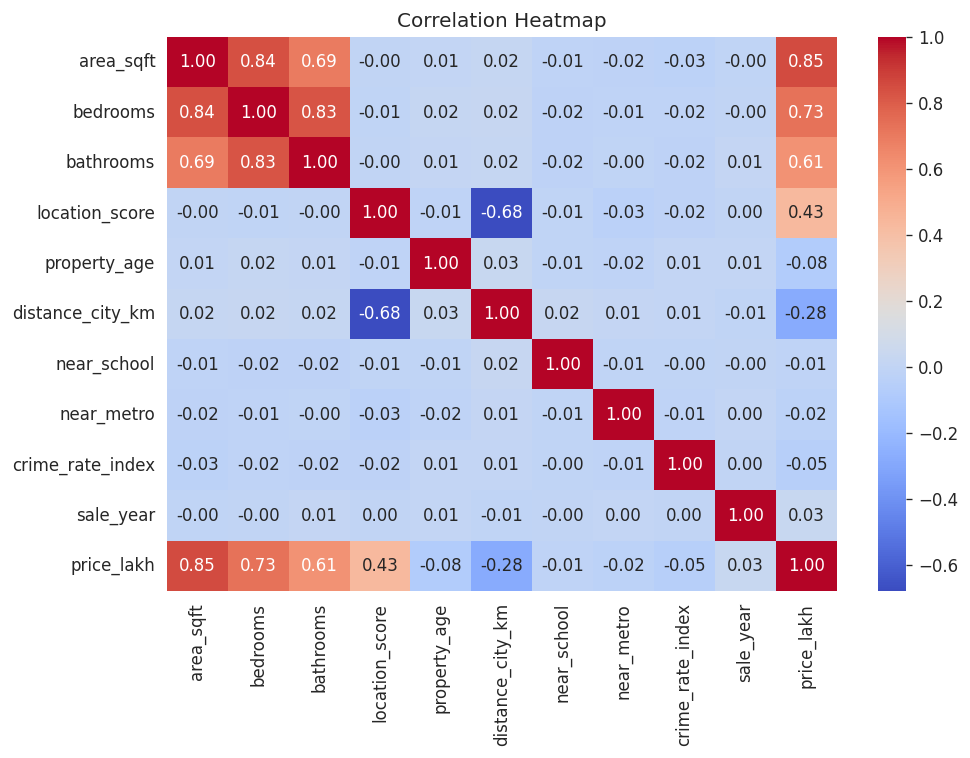
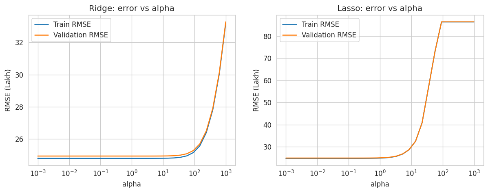
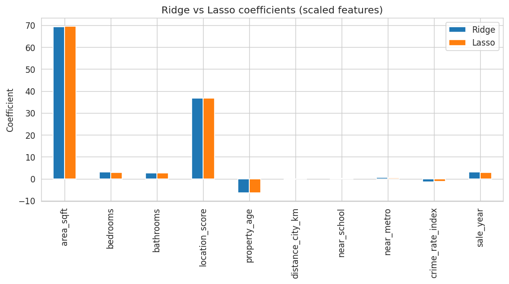
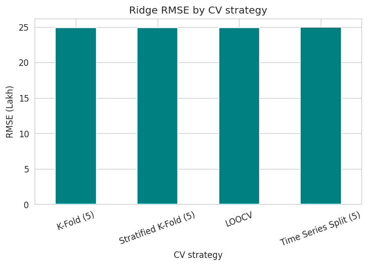
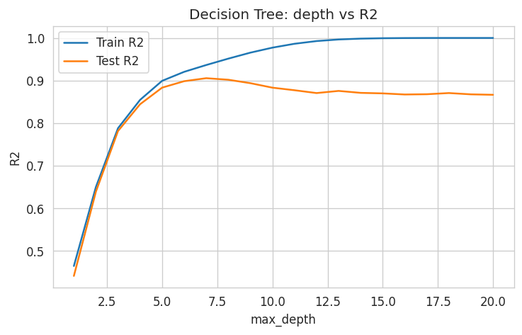
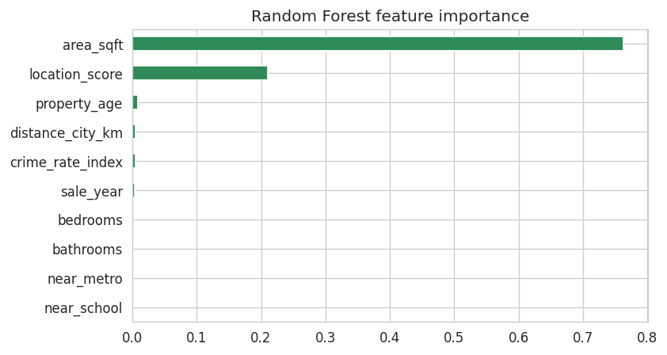
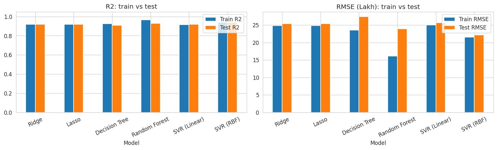
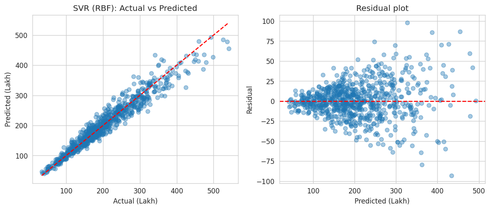

<div align="center">
# 🏠 Robust Regression Engine
### House Price Prediction using Regularization, Cross-Validation, Tree Models & SVR
 


 
**[🚀 Live App](#-project-links) &nbsp;|&nbsp; [📓 Notebook](PR2_Robust_Regression.ipynb) &nbsp;|&nbsp; [🎥 Video Explanation](#-project-links)**
 
</div>
---
 
## 📑 Table of Contents
1. [Overview](#-overview)
2. [Dataset](#-dataset)
3. [Workflow](#-workflow)
4. [Theory Summary](#-theory-summary-part-a)
5. [Results](#-results)
6. [Key Insights](#-key-insights)
7. [Visualizations](#-visualizations)
8. [Streamlit App](#-streamlit-app)
9. [Repository Structure](#-repository-structure)
10. [Quick Start](#-quick-start)
11. [Troubleshooting](#-troubleshooting)
12. [Limitations & Future Work](#-limitations--future-work)
13. [Project Links](#-project-links)
14. [Author](#-author)
---
 
## 📌 Overview
 
A real estate analytics company uses a basic regression model for **house prices**, but it **overfits** and gives **unstable predictions**. This project builds a **robust regression pipeline** that:
 
- ✅ applies **regularization** (Ridge L2, Lasso L1) with `alpha` tuned by cross-validation
- ✅ uses **proper cross-validation** (K-Fold, Stratified K-Fold, LOOCV, Time Series Split)
- ✅ compares **linear vs non-linear** models (Ridge, Lasso, Decision Tree, Random Forest, SVR)
- ✅ selects the **best model by validation performance**, not by test score
- ✅ serves the final model through a **Streamlit web app**
## 📊 Dataset
 
| Item | Detail |
|---|---|
| File | `Advanced_Regression_HousePrice_Dataset_3800.xlsx` |
| Size | 3,800 rows × 12 columns, **no missing values** |
| Period | Jan 2010 – Dec 2023 |
| Target | `house_price_inr` (modelled in **lakh INR**, 1 lakh = 100,000) |
 
| Feature | Description |
|---|---|
| `area_sqft` | Built-up area |
| `bedrooms`, `bathrooms` | Structural attributes |
| `location_score` | Location quality (1–10) |
| `property_age` | Age in years |
| `distance_city_km` | Distance from city centre |
| `near_school`, `near_metro` | Binary (0/1) proximity flags |
| `crime_rate_index` | Local crime index |
| `sale_year` | Derived from `sale_date` |
 
`property_id` is dropped (identifier only). `sale_date` is used to order data for the Time Series Split.
 
## 🧭 Workflow
 
```
Load data → EDA → 80/20 Train-Test split → Scaling (inside Pipeline, no leakage)
   → Ridge & Lasso (tune alpha) → Compare 4 CV strategies
   → Decision Tree & Random Forest → SVR (Linear, RBF)
   → Compare all models → Choose best by CV RMSE → Save model.pkl → Streamlit app
```
 
| Part | Topic | What was done |
|---|---|---|
| **A** | Theory | Regularization, L1 vs L2, CV types, trees vs scaling |
| **B** | Data preparation | Features/target, 80/20 split, `StandardScaler` in a `Pipeline` |
| **C** | Regularized linear models | Ridge & Lasso, `alpha` via 5-fold GridSearchCV, coefficient comparison |
| **D** | CV strategies | K-Fold, Stratified (binned target), LOOCV, Time Series Split |
| **E** | Tree models | Decision Tree (depth / min-leaf control), Random Forest |
| **F** | SVR | Linear & RBF kernels, tuned `C`, `gamma`, `epsilon` |
| **G** | Evaluation | MSE, MAE, RMSE, R², overfitting / underfitting diagnosis |
| **H** | Final analysis | Best model, impact of regularization, business interpretation |
 
## 📚 Theory Summary (Part A)
 
| Concept | Short explanation |
|---|---|
| **Regularization** | Adds a penalty on large coefficients so the model cannot memorise noise, which reduces overfitting. |
| **Ridge (L2) vs Lasso (L1)** | Ridge penalizes squared coefficients and shrinks them; Lasso penalizes absolute values and can set some to exactly zero (feature selection). |
| **Cross-Validation** | Repeated train/validation splits give a more reliable performance estimate and are used for tuning. |
| **K-Fold** | Data split into K parts; each part is used once as validation. |
| **Stratified K-Fold** | K-Fold that keeps class (or binned target) proportions equal in each fold. |
| **LOOCV** | One sample is validation each time; thorough but slow. |
| **Time Series Split** | Training data always precedes validation data in time, so no future leakage. |
| **Trees & scaling** | Trees split on thresholds of single features; rescaling does not change the order, so splits stay the same. |
 
## 🏆 Results
 
All metrics are on the **held-out test set** (errors in **lakh INR**).
 
| Model | CV RMSE | Train R² | Test R² | Test RMSE | Test MAE | Diagnosis |
|---|---|---|---|---|---|---|
| Ridge | 24.95 | 0.917 | 0.920 | 25.40 | 19.45 | Good fit |
| Lasso | 24.95 | 0.917 | 0.920 | 25.42 | 19.46 | Good fit |
| Decision Tree | 27.35 | 0.926 | 0.907 | 27.43 | 20.36 | Good fit |
| Random Forest | 23.78 | 0.965 | 0.929 | 23.95 | 17.50 | Good fit (small gap) |
| SVR (Linear) | 25.07 | 0.916 | 0.918 | 25.67 | 19.37 | Good fit |
| **SVR (RBF)** ⭐ | **22.25** | 0.938 | **0.939** | **22.20** | **16.23** | **Good fit** |
 
**Best hyperparameters**
 
| Model | Parameters |
|---|---|
| Ridge | `alpha = 2.04` |
| Lasso | `alpha = 0.117` |
| Decision Tree | `max_depth = 7`, `min_samples_leaf = 20` |
| Random Forest | `n_estimators = 200`, `max_depth = 12`, `min_samples_leaf = 5` |
| SVR (Linear) | `C = 100`, `epsilon = 5` |
| **SVR (RBF)** | `C = 300`, `gamma = 0.01`, `epsilon = 0.1` |
 
**Cross-validation comparison (tuned Ridge)**
 
| Strategy | Folds | Mean RMSE |
|---|---|---|
| K-Fold | 5 | 24.93 |
| Stratified K-Fold | 5 | 24.89 |
| LOOCV | 3,040 | 24.92 |
| Time Series Split | 5 | 24.95 |
 
## 🔍 Key Insights
 
- **Best model: SVR (RBF)**, with the lowest CV RMSE and highest test R² (0.939). It is off by about **16 lakh INR** per house on average (MAE).
- **Regularization works:** an unpruned decision tree has train R² 1.00 vs test 0.87 (clear overfitting). Limiting depth and leaf size cuts the gap to 0.02.
- **Cross-validation is stable:** all four strategies give RMSE between 24.89 and 24.95, so the estimates are trustworthy.
- **Non-linear beats linear** (R² 0.939 vs 0.920), but only modestly, so the underlying relationship is mostly linear.
- **Key price drivers:** `area_sqft` and `location_score` matter most; `property_age` and `crime_rate_index` lower the price.
- **Lasso kept all features**, so every feature carries some signal.
- **Business use:** quick price estimates, listing sanity-checks and market benchmarking.
## 🖼️ Visualizations
 
| Price distribution | Correlation heatmap |
|:---:|:---:|
|  |  |
 
| Alpha tuning (Ridge / Lasso) | Ridge vs Lasso coefficients |
|:---:|:---:|
|  |  |
 
| CV strategy comparison | Decision tree depth vs R² |
|:---:|:---:|
|  |  |
 
| Random Forest feature importance | Model comparison |
|:---:|:---:|
|  |  |
 
**Best model: actual vs predicted and residuals**
 

 
## 💻 Streamlit App
 
The app loads `model.pkl`, takes property details as input and returns an **estimated price in INR**. A second tab shows the model comparison table and chart.
 
If `model.pkl` is missing or incompatible with your scikit-learn version, the app **re-trains the best model automatically** from the dataset.
 
> 📸 **Add your screenshots here:** ``
 
## 📁 Repository Structure
 
```
Project_2/
├── PR2_Robust_Regression.ipynb                       # Full notebook (Parts A–H, executed)
├── app.py                                            # Streamlit app
├── model.pkl                                         # Best saved model (SVR RBF)
├── results.csv                                       # Model comparison table
├── Advanced_Regression_HousePrice_Dataset_3800.xlsx  # Dataset
├── plots/                                            # All saved charts
├── requirements.txt                                  # Dependencies
├── run_app.bat / run_app.sh                          # One-click launchers (Windows / Linux-Mac)
├── HOW_TO_RUN.txt                                    # Plain-text run guide
└── README.md
```
 
## ⚙️ Quick Start
 
> Keep **all files together in one folder**.
 
**Windows (easiest):** double-click `run_app.bat`.
 
**Manual:**
 
```bash
# 1. Clone (or unzip) and enter the folder
git clone https://github.com/<your-username>/<your-repo>.git
cd <your-repo>
 
# 2. (Optional) virtual environment
python -m venv venv
venv\Scripts\activate            # Mac/Linux: source venv/bin/activate
 
# 3. Install dependencies
python -m pip install -r requirements.txt
 
# 4. Run the Streamlit app
python -m streamlit run app.py
 
# 5. Or open the notebook, then Kernel > Restart & Run All
python -m jupyter notebook PR2_Robust_Regression.ipynb
```
 
## 🩺 Troubleshooting
 
| Problem | Fix |
|---|---|
| `streamlit` is not recognized | Use `python -m streamlit run app.py` |
| `FileNotFoundError: model.pkl` | Keep `app.py`, `model.pkl` and the `.xlsx` dataset in the **same folder**; the app can also retrain itself |
| Version warning when loading `model.pkl` | `pip install -U scikit-learn`, or delete `model.pkl` and let the app retrain |
| `ModuleNotFoundError` | Run `python -m pip install -r requirements.txt` |
| Notebook cannot find the Excel file | Start Jupyter from inside the project folder |
 
## 🚧 Limitations & Future Work
 
- Only 10 numeric features; no text, image or map-based features.
- The dataset looks synthetic and clean; real-world data would need more cleaning and outlier handling.
- Future ideas: Gradient Boosting / XGBoost, `log(price)` target, SHAP explainability, feature interactions, and a time-based hold-out for production monitoring.
## 🔗 Project Links
 
| Resource | Link |
|---|---|
| 🚀 Live Streamlit App |[ _add your URL_](http://localhost:8501/) |
| 🎥 Video Explanation | _add your Google Drive / YouTube (unlisted) link_ |
 
## 👤 Author
 
**Your Name**
GitHub: [@your-username](https://github.com/your-username) · LinkedIn: _add link_
 
---
 
<div align="center">⭐ If you found this useful, please star the repo!</div>
 
